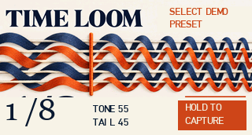
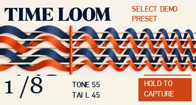

# Time Loom

弹完一句，按住下方旋钮就能把刚才那段声音留下来循环。松手以后，重复声会慢慢散掉。

## 配套音频包

先安装音频包，再安装 App。

- Time Loom DSP `org.resona.demo.time-loom-dsp` 0.1.2

## 两个编码器

| 页面／模式 | 上方旋转 | 上方短按 | 上方长按 | 下方旋转 | 下方短按 | 下方长按／按住 |
| --- | --- | --- | --- | --- | --- | --- |
| Time Loom | 顺时针更亮、尾音更短；逆时针更暗、尾音更长 | 干声对比开／关 | 重置音色和尾音、退出干声对比 | 选循环长度 2 秒／1 秒／500／250／125 毫秒 | 短踩可截取一小段并在松开时散开 | 按住截取并循环，松开让片段衰减散开 |

## 项目详细说明

# Time Loom

Hold a guitar phrase, weave it into short repeats, and let go to unravel it. The App always records your playing;
holding the big knob freezes the latest phrase and loops it while you keep playing over it. The sound is the nested
`dsp/` pack (**Time Loom DSP**); the App builds its own Guitar -> Time Loom DSP -> Output graph and drives it.

The pack must be installed in the Box's library first. Until it is, the App shows **INSTALL / LOOM DSP** and retries
once a second.

## Controls

| Control | Turn | Click | Long press / hold |
|---|---|---|---|
| SELECTOR (top) | brighter and shorter tail clockwise, darker and longer counterclockwise | DRY compare | reset tone and tail, exit DRY |
| CUSTOMIZE (big) | phrase length: 1/1, 1/2, 1/4, 1/8, 1/16 | | hold: capture and loop; release: unravel |

- Capture starts the moment the big knob goes down, with a soft entrance; the click after it is ignored.
- While held, the live guitar stays audible about 3 dB down. On release it returns to full level and the phrase
  unravels into a decaying tail.
- The divisions assume a fixed **120 BPM**: 2 s, 1 s, 500, 250 or 125 ms (default 1/8). There is no tap tempo and no
  sync to an external clock.
- The top knob sets TONE and TAIL together (TAIL = 100 - TONE); a controller sets TAIL on its own.

Division, tone, tail, repeats and DRY are saved 1.2 s after the last change.

If the OS bypasses the DSP for its CPU budget, the App shows **CPU LIMIT**, drops its graph and rebuilds it after
2 s, then 10 s, then 30 s while trips keep coming; a top long press retries at once.

## The screen

A woven visual (`art/background.png`, from `art/reference.png`) with the App's text on top:

- **Top right**: LIVE, CAPTURED, UNRAVEL or DRY, over the input meter.
- **Bottom left**: the division as a large fraction; TONE and TAIL beside it.
- **Bottom right**: HOLD TO CAPTURE, or RELEASE TO UNRAVEL while held.
- **The shuttle**: a red bar that crosses the loom once per phrase while capturing and unravelling.

Creator Lab's local App preview has an empty library and does not run the DSP.

## Controller

Web (`controller/web/`), Mobile (`controller/mobile/`) and any MIDI controller play Time Loom: one CC per control on
channel 1, and CC 119 asks the App for every value. Page PLAY shows what the loom is doing and has the hold pads and
a Tone × Repeats pad; page LOOM has every setting. STUTTER captures a 1/16 phrase and unravels it at 1/16; the chosen
division returns when the tail ends.

| CC | Control | Values |
| --- | --- | --- |
| 20 | Phrase | 0 1/1, 1 1/2, 2 1/4, 3 1/8, 4 1/16 |
| 21 | Tone | 0–127 = 0–100 |
| 22 | Tail | 0–127 = 0–100 (0.25–3 s) |
| 23 | Repeats | 0–127 = 0–100 % (default 80) |
| 24 | Dry compare | 0 off, 1 on |
| 25 | Loom (App to controller) | 0 LIVE, 1 CAPTURED, 2 UNRAVEL, 3 DRY |
| 30 | HOLD pad | 127 captures, 0 unravels (like holding the big encoder) |
| 31 | STUTTER pad | 127 captures at 1/16, 0 unravels |
| 32 | DRY pad | 127 bypasses while held, 0 releases |
| 116 / 117 | Input / output meter | sent by the App to a port that sent CC 119 |
| 119 | Query | any value: the App answers with every value |

The settings record (v2) adds TAIL and REPEATS; a v1 record still loads (TAIL = 100 - TONE, REPEATS 80).

### Bench control (bench builds only)

Only in a build with `-DRESONA_DEMO_BENCH` (also the screen-capture SysEx); a normal build ignores these. MIDI
channel **16** CCs call the same handlers as the knobs:

| CC | Action |
| --- | --- |
| 20 | Top turn; value = 64 + signed detents |
| 21 | Bottom turn; value = 64 + signed detents |
| 22 | Top raw key; 127 down, 0 up |
| 23 | Bottom raw key; 127 captures, 0 unravels |
| 24 / 25 | Top / bottom synthetic click |
| 26 / 27 | Top / bottom synthetic long |

Send input audio for at least 0.5 s before CC 23 = 127.

## DSP: Time Loom DSP

    input -> always recording into one of two 2.73 s banks (PSRAM)
          HOLD: the latest phrase loops at DIVISION through a COLOUR low-pass; live guitar -3 dB
          release: the loop decays over DECAY  -> MIX with the guitar -> soft knee above 0.8

Capturing swaps the banks' roles without copying, so the other bank keeps recording. Loop seams, captures,
recaptures and division changes crossfade over 15 ms. The loop has no accumulating feedback. Mono, 48 kHz.

| Parameter | Range | Set by the App |
|---|---|---|
| DIVISION | 0 to 4: 1/1 to 1/16 at 120 BPM | big turn (default 3, 1/8); 1/16 while STUTTER is held |
| COLOUR | 0 to 100 | top turn (55 after a reset) |
| HOLD | 0 / 1 | big hold, or the HOLD / STUTTER pad |
| MIX | 0 to 100 (repeat amount) | 80, or the controller |
| DECAY | 0 to 100: tail 0.25 to 3 s | 100 - COLOUR from the top turn (45 after a reset), or the controller |
| BYPASS | 0 / 1 | top click, or the DRY pad |

## Build

    resona-lab check dsp
    resona-lab pack build dsp
    resona-lab pack install dsp/build/*.rpk     # the Box's library: no preset slot is written
    resona-lab app build .
    resona-lab app install .
    python3 tools/bake_art.py                   # regenerate src/art.h from art/reference.png (Pillow, local fonts)
    python3 tools/test_dsp.py                   # host tests of the built pack; never opens USB or audio

`src/art.h` is self-contained; a normal build needs no Pillow, fonts or images. No font binary is distributed.

MIT, see LICENSE. `art/reference.png` is a generated visual study; `art/background.png` and `src/art.h` are its
encoded screen version.

DRY 淡入后直接输出吉他干声，强拨弦也保留原始动态。

## 开机动画

开机时红色梭线从左往右带出红蓝织带，最后显示 TIME LOOM。动画约 1.6 秒。安装后由 App 保存，下一次启动时播放。可运行 `python3 tools/make_splash.py` 重新生成。
